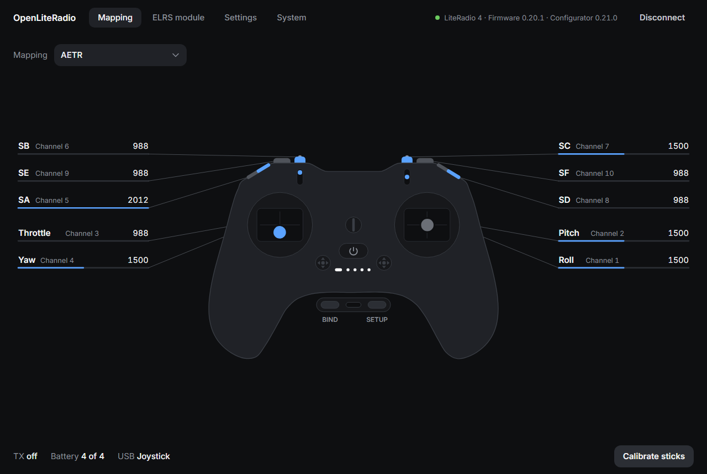

# OpenLiteRadio

Open firmware for the BETAFPV LiteRadio 4, built on
[Zephyr](https://zephyrproject.org/) and set up in the browser.

**Configurator: <https://mvoss96.github.io/OpenLiteRadio/>** (Chrome or Edge,
in English and German)

It works with the ExpressLRS firmware the radio ships with. To update
ExpressLRS, see
[literadio4-elrs-target](https://github.com/mvoss96/literadio4-elrs-target).

**Experimental:** tested on the bench with a Betaflight quad, not flown yet.

## Features

- Sticks with calibration and dead zone, all switches, trim
- Channel order AETR, TAER or your own, with weight and reverse
- ExpressLRS: binding, WiFi, Bluetooth joystick, all module settings
- Throttle lock at power-on
- USB joystick or Xbox 360 controller for simulators
- Tones and volume, battery level, link and low-battery warnings
- Firmware update from the browser

Details and test status: [docs/FEATURES.md](docs/FEATURES.md).

## Install

1. Open the [configurator](https://mvoss96.github.io/OpenLiteRadio/) and press
   "Flash firmware".
2. Switch the radio off and unplug USB. Hold SETUP and switch it on until the
   double beep. Plug USB in.
3. Press "Next" and choose the updater in the browser's window.
4. Press "Flash".
5. When it is done, unplug USB.
6. Calibrate the sticks: press "Connect", then "Calibrate sticks".

**Update:** switch the radio off, connect, then System → "Update" → "Flash".

**Back to stock:** System → "Update" → "Other file", choose the
`LiteRadio_4_ELRS_…bin` file from
[BETAFPV's download page](https://support.betafpv.com/hc/en-us/articles/36869017436953-LiteRadio-4).

## Buttons

| Action | Buttons |
|---|---|
| Power on | hold power 1 s |
| Power off | hold power until the LEDs are out |
| Unlock | throttle down (or up, then down, if set) |
| Bind | hold BIND 1 s; a short press cancels |
| Bluetooth joystick | hold the left trim centre while switching on |
| WiFi of the ELRS module | hold the right trim centre while switching on |
| Joystick or Xbox controller | hold both trim centres 2 s, radio off and at a PC |
| Reset trim | hold a trim centre 1 s |
| Calibrate sticks | hold SETUP 2 s; a short press ends it |
| Show link quality on the battery LEDs | short press on SETUP |
| Update mode | USB unplugged, hold SETUP and switch on |

## Status LED

| Colour | Meaning |
|---|---|
| Blue | sending, receiver connected |
| Blue, blinking | sending, no receiver |
| Red | locked, receiver connected |
| Red, blinking | locked, no receiver |
| Cyan, blinking | binding |
| Yellow, blinking | calibration |
| Green, blinking | WiFi |
| Purple | Bluetooth joystick |
| White | off, USB joystick |
| Yellow | off, Xbox controller |
| Orange flashes | low battery |

The four small LEDs show the battery level. The highest one blinks while USB
powers the radio; the leftmost blinks when the battery is low.

## Development

- [docs/BUILD.md](docs/BUILD.md): build, tests, command-line tools
- [docs/ARCHITECTURE.md](docs/ARCHITECTURE.md): firmware layers and the USB protocol
- [docs/WIRING.md](docs/WIRING.md), [docs/HARDWARE.md](docs/HARDWARE.md): pins and measurements
- [docs/ZEPHYR.md](docs/ZEPHYR.md): Zephyr setup

## License

GPL-3.0, see [LICENSE](LICENSE).
