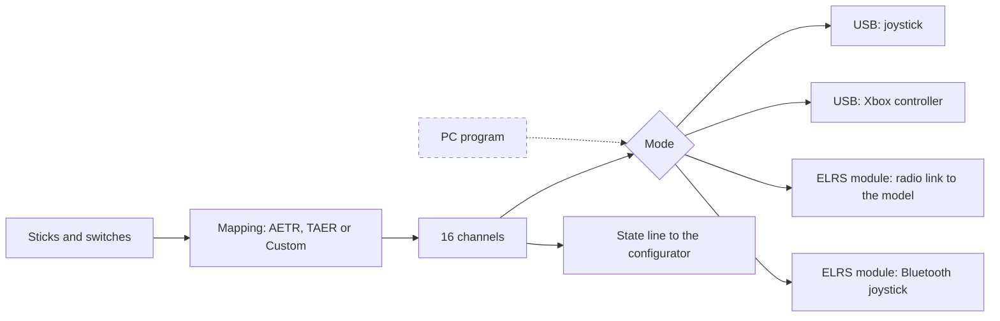
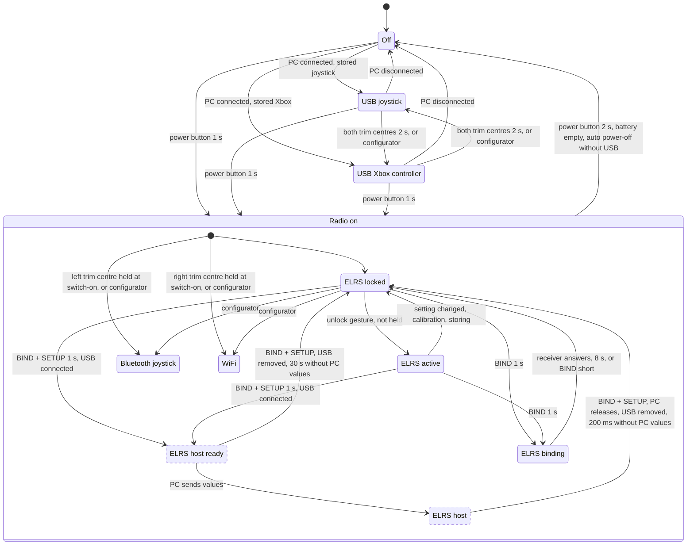
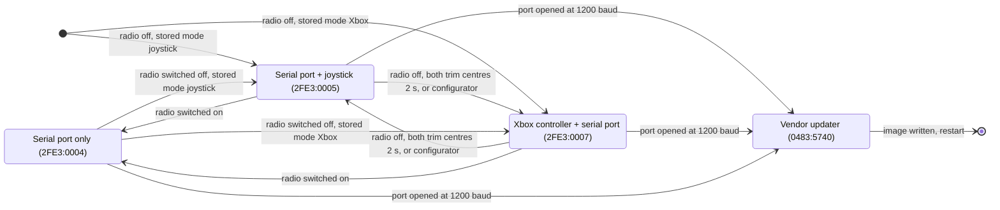

# Firmware architecture

Agreed on 2026-11-17. The scope is in [FEATURES.md](FEATURES.md), the hardware
in [WIRING.md](WIRING.md).

## Constraints

- 20 KiB RAM. Zephyr with the USB serial port takes about 14 KiB, which leaves
  about 6 KiB for application data and thread stacks.
- The ELRS module sets the frame rate: 250 Hz by default, up to 1000 Hz. The
  path from stick to CRSF frame has to keep that rate.
- C++20 without exceptions, RTTI, heap or C++ standard library: fixed arrays
  and plain classes.

## Layers

| Layer | Directory | Content | Touches hardware |
|-------|-----------|---------|------------------|
| board | `src/board/` | sticks, switches, buttons, trim keys, shift register, status LED, buzzer, power latch, battery input, module enable | yes, and only this layer |
| core | `src/core/` | calibration, dead zone, channel assignment, trim, CRSF encoding and decoding, parameter access, action table, settings model | no |
| app | `src/` | operating modes, threads, host protocol | through board only |

The app layer is one file per task: `output.cpp` (control thread, holds,
throttle lock, test inputs), `module_link.cpp` (frames from the module, link
statistics, binding), `host.cpp` (line protocol and state lines),
`storage.cpp` (settings in flash), `calibration.cpp` (stick
calibration run), `indicators.cpp` (buzzer and status LED), `usb_device.c`
(the USB device in its forms: serial port, joystick, Xbox controller),
`usb_xinput.c` (the Xbox controller's interface) and `main.cpp` (start,
power button, BIND and SETUP, the USB device's form, the main loop). Only `output.cpp` touches the state shared between the
two threads; the others go through its functions.

The core layer contains everything where an error is dangerous or hard to see
on the radio. Because it touches no hardware it is also compiled for the PC and
checked there with fixed inputs.

## Threads

- Control thread, high priority, at the module's frame rate: read sticks and
  switches, compute channels, send the CRSF frame or the USB controller's
  report.
- Main thread, low priority, 50 Hz: buttons and actions, LED and buzzer
  patterns, battery, power, CRSF parameters, host protocol.
- Bytes from the module arrive by interrupt in a ring buffer and are parsed in
  the main thread.

Each further thread would cost about 1 KiB of stack.

## Decisions

- Tests for the core layer run on the PC.
- Settings use Zephyr's NVS as long as flash allows, in the four 1 KiB pages
  at the top of the application area (0x0801F000 to 0x08020000); the image
  is limited to the 92 KiB below them. The vendor updater erases only as many pages as the
  image needs, so settings survive a firmware update. Flash below 0x08008000
  is not touched. The factory calibration there is not used: it does not fit
  the stick readings (docs/HARDWARE.md).
- The radio knows its settings: `src/core/settings.cpp` lists key, range and
  default of each one and reports them on request. The configurator adds
  labels and layout only, and shows a setting it has no label for on its
  Advanced tab. Each setting is a 16-bit value with its own NVS id; only
  values that differ from the default are stored, so settings added later do
  not disturb stored ones.
- The configurator is `web/index.html` with `web/app.js`: plain HTML and
  JavaScript without a build step, opened from the file system. Its main view
  edits the assignment from the control's side ("SE sends on channel 9");
  the page translates that into the per-channel `ch.N.source` settings. A
  control can therefore sit on several channels, and a channel can follow
  nothing.
- The USB serial port is always available for configuration and update when a
  cable is plugged in, also while the radio is switched on. It goes away
  briefly whenever the USB device changes its form (see "USB device").
- The status LED is driven by TIM2 with DMA, not by timed loops with
  interrupts masked, so that no CRSF byte is lost while a colour is sent.

## Operating modes

Agreed on 2026-11-19. The radio is in exactly one mode at a time: off, a
USB controller at a PC, or one of the ELRS modes. It is never a USB
controller and a remote control for a model at once, so that a model on the
bench does not follow the simulator. Today the logic is spread over flags in
`src/output.cpp`; it is to become one tested state machine in
`src/core/mode.cpp`. In the diagrams, dashed states are planned; the rest is
built.



### Modes

```cpp
/* What the radio is doing; exactly one at a time. */
enum class Mode : uint8_t {
    OFF,              // radio off, no PC: nothing (charging only)
    USB_JOYSTICK,     // radio off at a PC: DirectInput joystick from the controls
    USB_XBOX,         // radio off at a PC: Xbox controller from the controls
    ELRS_LOCKED,      // radio on: channel frames with safe values
    ELRS_ACTIVE,      // radio on: frames with the controls
    ELRS_HOST_READY,  // PC control allowed at the radio: as locked until the PC sends values
    ELRS_HOST,        // frames with the values from the PC, controls ignored
    ELRS_BINDING,     // bind command sent; the module looks for a receiver
    BLUETOOTH,        // module is a Bluetooth joystick: frames with the controls, no lock
    WIFI,             // module runs its web page for updates: pings only
};
```



Switching off at a PC leads to the stored USB mode instead of Off. "At a PC"
needs both the controller interface set up by the PC and the USB supply: the
USB stack does not report a pulled cable, so after unplugging the radio
stayed a USB joystick and the LED flashed white when switched off on
battery. While the radio is on, the USB device is the serial port only, so
no USB controller exists in the ELRS, Bluetooth and WiFi modes. The joystick
and the Bluetooth joystick report a high channel as a high axis value, which
Windows draws downwards (pitch up moves the cross down); simulators set the
direction per axis. The Xbox controller reports a high channel as a positive
value, which XInput counts as up and right. Battery
empty and auto power-off are planned. WiFi and Bluetooth end only by
switching the radio off, since the module leaves them only by a restart.

| Mode | Frames to the module | Values from | USB controller |
|------|----------------------|-------------|----------------|
| Off | none, module off | – | – |
| USB joystick / Xbox | none, module off | controls | reports |
| ELRS locked | one channel frame per frame period | fixed safe values | – |
| ELRS active | one channel frame per frame period | controls | – |
| ELRS host ready (planned) | as locked | – | – |
| ELRS host (planned) | one channel frame per frame period | PC program on the serial port | – |
| ELRS binding | safe frames | fixed safe values | – |
| Bluetooth joystick | one channel frame per frame period | controls, untrimmed | – |
| WiFi | pings | – | – |

Built: Off, USB joystick, USB Xbox controller, ELRS locked, ELRS active,
binding, Bluetooth and WiFi in `src/core/mode.cpp` and `src/output.cpp`. The
serial port stays available in every mode. Safe values are the channels computed
by `core::safe_controls()`: throttle at its lower end, the other sticks at
their centres, every switch in its first position, with each channel's
mapping, weight and reverse; channels without a source stay centred.

- **Locked sends safe channel frames, as EdgeTX keeps sending.** The
  receiver stays connected and gets the throttle down, the sticks centred and
  every switch in its first position; for a copter with the arm switch on a
  switch channel that is disarmed. Pings alone would let the receiver enter
  its own failsafe (measured below), but then it has no link at the desk: an
  ELRS receiver starts its WiFi after 60 s without a link and does not
  connect until restarted, and the link quality is unknown while locked. The
  status LED blinks red without a receiver.
- **What the module does with pings only.** The
  module answers requests only while valid CRSF frames keep arriving, of any
  type (measured 2026-11-19: with one channel frame and then pings every
  20 ms it answered for 5.6 s; without frames it does not answer). Without
  frames it drops the connection to the radio after 1 s and searches the baud
  rate again. It stops sending channel data over the air once its last
  channel frame is older than 1 s; before its first channel frame it would
  send the zero-initialised `ChannelData` array, all channels at the lower end
  (ELRS 3.6.4 source). A bound receiver then enters the failsafe configured
  for that model, while the module still answers parameter requests.
- Measured on 2026-11-19 with a Betaflight 2026.6.1 quad (BETAFPV Air65, ELRS
  3.6.4 receiver, powered from USB only) read over MSP: with the output held
  and no frames at all, Betaflight entered failsafe 1.4 s after the last
  channel frame and the link returned 3.6 s after the output was released;
  with pings every 20 ms instead, failsafe came after 1.35 s, the module kept
  answering, and the link returned 0.6 s after the release. After the module
  is switched on, the first link takes about 4.8 s. With safe frames until
  the module answers and pings every 20 ms after that, and the module
  switched on while held, Betaflight stayed in failsafe for 8 s and never
  received channel values, the module answered throughout, and the radio
  controlled the quad 0.14 s after the release. A receiver that has been
  without a link for 60 s starts its WiFi and does not connect until it is
  restarted.
- PC control is allowed only at the radio: with the radio on and USB
  connected, BIND and SETUP held together for 1 s. The PC alone can never take
  over. While both buttons are down, neither binding nor calibration starts.
- Every end of PC control leads to Locked, without exceptions. The receiver
  gets the safe values, and the controls take over only after the unlock
  gesture, so the throttle cannot jump. Sending the last PC values on would
  keep a model moving.
- Calibration and storing are not modes of their own: while they hold the
  output, Locked does not evaluate the unlock gesture.
- Every change of mode while the radio is on gives a tone.

### USB device

The radio presents one device description per enumeration, so changing the
form means disconnecting from USB and enumerating again. Each form has its
own product ID, because Windows caches a device's description per vendor and
product ID.



- The mode is the setting `usb.mode` (0 joystick, 1 Xbox controller). It is
  stored and applies at every further connection; `set usb.mode` stores it at
  once, since the port goes away with the change. BIND + SETUP stays reserved
  for PC control.
- `main.cpp` chooses the form in the main loop; `usb_device_select()` shuts
  the USB stack down, signals a disconnect and builds the device anew. The
  board ties D+ (PA12) to its pull-up and the STM32F103 cannot switch it off,
  so stopping the USB peripheral alone leaves the device on the bus: the host
  noticed the change from joystick to Xbox, but not the one back.
  `board::signal_usb_disconnect()` therefore drives D+ low for 20 ms, as the
  vendor bootloader does before it jumps. If a form cannot be built, the
  device falls back to the serial port only, prints `error usb FORM ERR` and
  gives a low tone.
- The Xbox form: our own vendor ID and the compatible ID `XUSB10` in an MS OS
  2.0 descriptor make Windows 11 load its "Xbox 360 Controller for Windows"
  driver for interface 0; the serial port follows as interfaces 1 and 2. The
  Microsoft controller's IDs are not needed. LED and rumble commands from the
  host are read and dropped.
- Xbox assignment, fixed in `src/core/xbox.cpp`: left stick channels 4 and 3,
  right stick 1 and 2, triggers 5 and 6 (988..2012 as 0..255), buttons A, B,
  X, Y, LB, RB, Back, Start channels 9 to 16 (pressed above 1500). Channels 7
  and 8 have no element. Open: one setting per element, a channel or none.

### ELRS module

The module has its own processor and firmware. The radio switches it on and
off and starts actions through CRSF parameters: binding, Bluetooth joystick
and WiFi are commands of the module (modes above). The module leaves
Bluetooth and WiFi only by a restart, so the radio returns from them by
switching the module off.

Read from the module on 2026-11-19: "BETAFPV LiteRadi", ELRS 3.6.4 ISM2G4,
21 parameters: Packet Rate, Telem Ratio, Switch Mode, Link Mode, Model Match,
the folder TX Power (Max Power 25/50/100 mW, Dynamic), the folder VTX
Administrator (Band, Channel, Pwr Lvl, Pitmode, Send VTx), the folder WiFi
Connectivity (Enable WiFi, Enable Rx WiFi), the commands BLE Joystick and
Bind, and the read-only entries Bad/Good and the version.

The configurator gets a tab "ELRS-Modul" that shows everything the module
offers. It reads the list from the module through the radio, which only
passes the frames on, so another ELRS version with other parameters needs no
change. The module is configured with the radio switched on, also while
locked; with the radio off the tab shows no values and asks to switch the
radio on.

Built in `web/elrs.js`: while the tab is open the page sends `frames 1`,
pings the module, reads the device information and every entry with all its
chunks (`crsf` with 0x28 and 0x2C, answers 0x29 and 0x2B in `rx` lines), and
reads the list again every 2 s and after every change. A choice is written
with 0x2D; a command is started by writing 1, and while the module asks for
confirmation (status 3) its button sends 4. Known ELRS 3.6 names get German
labels and fixed groups (Funk, Sendeleistung, Videosender, Empfänger,
Modul); any other entry appears under its folder's name or in Modul. Hidden
entries and folders themselves are not shown. The receiver's link comes
from the state line. Bind, WiFi and the Bluetooth joystick are started
through the radio's own commands `bind`, `wifi` and `ble`, so that the radio
knows its mode. Next to the title the tab says
"TX aktiv" (mode `elrs_active`) or "TX gesperrt"; the status bar says
TX aus, gesperrt or aktiv.

While the radio sends to a receiver, every page shows a band "TX aktiv"; changes reach the model at once. Nothing is disabled:
with `unlock.mode` 1 and the throttle down a lock is released in the next
frame, so greying out until a lock would leave nothing changeable.

### Mapping and trim

- The mapping is one of three: AETR and TAER are fixed, Custom is the own
  mapping (channels, weight, reverse). The choice and the Custom mapping are
  stored and changed only from the PC. Changing AETR or TAER turns it into
  Custom with the template as starting point; an existing Custom mapping is
  replaced after a question. There are no profiles. Built in 0.9.0: the
  setting `map.mode` (0 AETR, 1 TAER, 2 Custom, default AETR) chooses the
  mapping; `core::compute_channels()` takes AETR and TAER from fixed tables
  (weight 100, no reverse) and Custom from the settings `ch.N.*`, which keep
  their values while a fixed mapping is chosen. Custom is stored as the
  `ch.N.*` settings, which the configurator writes anyway; several Custom
  mappings would need slots of their own. Export and import of the mapping
  as a file follow in the configurator.
- Trim shifts the centre of the four stick axes, 4 µs per step, at most ±25
  steps. It is stored apart from the mapping and changed with the trim
  buttons, a short tone per step and another at the centre. It applies only to
  the frames to the ELRS module, not to joystick and Xbox. The trim centres do
  nothing while the radio is on; trim is reset from the configurator. Built in
  0.11.0: the settings `trim.thr`, `trim.rud`, `trim.ele`, `trim.ail` (−25..25
  steps of `core::TRIM_STEP_US`) are added to the stick source before weight
  and reverse, and every channel is limited to 988..2012. Left trim button up
  and down trim the throttle, left and right the yaw; the right button pitch
  and roll. The buttons work only while the radio is on, one step per press,
  the stock firmware's tones: 1176 Hz 100 ms for a step away from the centre,
  784 Hz 100 ms towards it, 989 Hz 300 ms when a trim reaches 0. The stock
  firmware has no tone for the end; here 659 Hz 300 ms sounds at ±25 and for
  every press beyond. The stock tones were read from its disassembly (TIM3
  prescaler 99, a table of nine periods at 0x08008d68, chosen at 0x08011fde),
  not recorded on the radio. Writing to flash holds the output and locks it, so trim from
  the buttons is stored only when the radio is switched off (`storage::save_trim()`,
  only the trim values). The state line reports `trim=` and `ch=` as sent:
  trimmed while the module is on.

### LEDs

One colour per state. One colour steady is a normal state, slow blinking
(0.5 s on, 0.5 s off) a special mode or a notice, fast blinking (0.1 s on,
0.1 s off) an error in red or PC control in blue. When several states
apply, the upper row wins. Each code was looked at on the radio and chosen
there: alternating with white was hard to read and pulsing hard to see at
this brightness.

| State | Status LED |
|-------|------------|
| Error (storage, module does not answer) | red, fast blinking |
| Calibration | yellow, slow blinking |
| Binding | cyan, slow blinking |
| Module in WiFi mode | green, slow blinking |
| On, Bluetooth joystick | purple |
| On, locked, receiver connected | red |
| On, locked, no receiver | red, slow blinking |
| On, PC in control | blue, fast blinking |
| On, sending, receiver connected | blue |
| On, sending, no receiver | blue, slow blinking |
| Off, at a PC as joystick | white |
| Off, at a PC as Xbox controller | yellow |
| Off, on a charger or without USB | off |

Built in `src/core/led.cpp` (with tests) for every row; the rows of modes
that have no transitions yet (error, PC)
show once those modes exist. The colours are driven at about a fifth of the
LED's range; white is 0x181818. Orange (0x300500) for the joystick was
too close to red on the radio. "Receiver connected" means link statistics with a link quality above
0 arrived within the last second. The host command `led` still overrides
the LED until `led auto`.

The four battery LEDs show the charge, four to one; below one the last LED
blinks, with a warning tone if enabled. Still to be observed on the device:
what the vendor bootloader shows on these LEDs.

## Stages

| Stage | Result | State |
|-------|--------|-------|
| 1 | board layer, power on/off, LED, buzzer, host protocol with live view | built, see below |
| 2 | flying: factory calibration, channels, CRSF at the module's rate, throttle lock, binding | in progress, see below |
| 3 | settings storage, trim, calibration on the radio | storage and calibration built, trim open |
| 4 | USB joystick, then Xbox mode | both built (DirectInput joystick and Xbox controller, each beside the serial port); per-element Xbox assignment open |
| 5 | configuration protocol for the web tool | settings commands, the configurator's views and the USB mode built; ELRS parameters, buttons, update and backup open |
| 6 | Bluetooth, WiFi, battery display, remaining features | open |

Stage 1 as built: the power button switches the radio on after 1 s and off
after 2 s. The status LED follows the codes in "LEDs".

Stage 2 as built so far:

- `src/core/channels.cpp` scales the sticks with the calibration in the
  settings `cal.N.*`. Each of the 16 channels follows the source in
  `ch.N.source` (0 none, 1 aileron, 2 elevator, 3 throttle, 4 rudder, 5 to 10
  SA to SF), scaled around the centre by `ch.N.weight` percent and reversed
  with `ch.N.reverse`. By default channels 1 to 10 follow sources 1 to 10.
  Self-centring axes have a dead zone around the centre, set per axis in
  `cal.N.deadzone` as a percentage of the half range (0 to 10, default 1);
  inside it the output is exactly 1500. The throttle has none.
- `src/core/crsf.cpp` builds channel frames and parses what the module sends.
- The control thread sends one channel frame per frame period while the
  module is on. The period starts at 4 ms and follows the interval in the
  module's timing frames. The offset in those frames says how early or late
  the last frame arrived. The radio holds it at +500 µs: one frame period is
  stretched or shortened by half the difference, by at most a quarter of the
  interval. Each frame time is carried forward from the previous one, so the
  time the control thread spends and the rounding to 100 µs kernel ticks do
  not add up. Measured with a bound receiver: the offset stays between +400
  and +580 µs and the module sends only its regular timing frame every
  200 ms.
- Throttle lock: the radio starts locked. After every start of the module
  and after every changed setting no frame is sent until the unlock gesture
  in `unlock.mode` was made: 1 throttle at its lower end (default), 2
  throttle at its upper and then its lower end. With 1 and the throttle
  already down, a lock from a changed setting or from `lock` is released in
  the next frame. The status LED is red while
  locked; one tone marks the release unless `unlock.beep` is 0. `buzzer.on`
  0 silences all tones.
- Switching the radio on starts the module, switching it off stops it.
- Module commands (0.12.0, `src/module_link.cpp`): binding (BIND held 1 s,
  host `bind`), WiFi (right trim centre held at switch-on, host `wifi`) and
  the Bluetooth joystick (left trim centre held at switch-on, host `ble`).
  Once the module answers after switching on, the firmware asks it for its
  number of parameters, reads the entries until the command's name comes
  ("Bind", "Enable WiFi", "BLE Joystick"), keeps every command number met on
  the way until the next reset, and writes 1 for Bind and 4 (confirmed) for
  WiFi and Bluetooth, which the module would otherwise ask about while a
  receiver is connected. Then the module's task sets the mode. A tone reports
  that the command was sent, a low one that the search failed. Binding ends
  when link statistics arrive at least 1.5 s after the start (high tone),
  after 8 s (low tone) or with a short press of BIND; ELRS 3.6.4 itself binds
  for 25 bind packets, about 1 s, and reports no end. Measured with
  `module 1`: binding after 0.6 s, back to locked after 8 s without a
  receiver in bind mode; with `wifi` the module's web page answered after
  7 s and the module kept answering pings; `ble` gave the Bluetooth mode.
- Stick calibration, taken from stage 3 because the factory calibration does
  not fit the readings (docs/HARDWARE.md): SETUP held for 2 s starts a run,
  the status LED blinks yellow and no channel frames are sent. The sticks are
  moved to all ends. A short press of SETUP ends the run with the right stick
  released and the throttle left at its lower end. The released readings
  become the centres and the throttle's lower end, the other ends are the
  extremes moved inward by 25 counts. A high tone reports that the result is
  in the settings `cal.N.*` and all settings are stored, a low tone that it
  was rejected or not stored. Without a run the built-in values 600, 2048
  and 3500 apply.
- Missing from stage 2: the other module parameters (packet rate, power,
  telemetry ratio), averaging of the stick readings.

## Tests

`./test.ps1` compiles `src/core/` and `tests/core_tests.cpp` with the PC's
g++ and runs the result. The tests use fixed inputs, among them a timing frame
recorded from the module.

## Host protocol

Text lines on the USB serial port, one message per line, fields separated by
spaces. It is readable in a terminal and parsed by `web/app.js`. Opening
the port at 1200 baud restarts the radio into the vendor USB updater.

From the radio:

- `hello OpenLiteRadio <version> proto=1`, at start and on request. After
  a fatal error the radio restarts instead of halting; the next hello line is
  followed once by `fault reason=N pc=0x... lr=0x...` (Zephyr's reason code
  and the faulting addresses).
- `error usb FORM ERR` when the USB device could not be built in a form
  (`FORM` 1 joystick, 2 Xbox) and fell back to the serial port only.
- `state key=value ...`, 25 times per second while streaming. Keys: `sticks`
  (four raw 12-bit values: left vertical, left horizontal, right vertical,
  right horizontal), `sa`, `sd` (0 or 1), `sb`, `sc` (0, 1, 2), `se`, `sf`,
  `bind`, `setup`, `power` (1 while pressed), `tl`, `tr` (trim buttons: bit 0
  up, 1 down, 2 left, 3 right, 4 centre), `keys` (1 if the trim key device
  answers), `battery` (raw 12-bit), `usb` (1 with USB supply), `on`, `module`,
  `trim` (trim steps of throttle, yaw, pitch, roll), `ch` (channels 1 to 16
  in microseconds, 988 to 2012, trimmed while the module is on), `lock` (1 while the
  throttle lock holds the output back), `period` (frame period in
  microseconds), `frames` and `crc` (frames received from the module with a
  correct and with a wrong checksum), `lq` (percent) and `rssi` (dBm without
  the sign) from the receiver's link statistics, both 0 when none arrived
  within the last second, `offset` (microseconds, from
  the last timing frame), `bindpar` (number of the module's bind parameter, 0
  until it was searched), `tx` and `txbusy` (frames the control thread
  handed to the module's UART, and those refused because the previous one
  was still being sent), `mode` (the mode, e.g. `usb_joystick`, `usb_xbox`,
  `elrs_locked`, `elrs_active`, see "Operating modes"), `led` (the colour as
  RRGGBB now sent to the status LED, blinking included; the configurator
  draws it brightened), `calib` (1 during a calibration run).
- `setting KEY TYPE MIN MAX DEFAULT VALUE`, one line per setting after `list`,
  followed by `end`. TYPE is `bool` or `int`.
- `value KEY VALUE` after `get`; `ok ...` or `error REASON` after the other
  settings commands.

To the radio:

| Line | Effect |
|------|--------|
| `hello` | send the hello line |
| `stream 0` / `stream 1` | stop or start the state lines |
| `led R G B` | status LED colour, 0 to 255 each; `led auto` returns control to the firmware |
| `beep HZ MS` | tone |
| `batleds MASK` | battery LEDs, bit 0 is the leftmost |
| `bind` | start binding, as holding BIND for 1 s does |
| `wifi` | start the module's WiFi, as the right trim centre at switch-on does |
| `ble` | start the module's Bluetooth joystick, as the left trim centre at switch-on does |
| `module 0` / `module 1` | ELRS module off or on; channel frames follow once the throttle lock is released |
| `frames 0` / `frames 1` | stop or start printing every frame from the module as `rx` and its bytes in hex |
| `crsf HEX` | send one complete CRSF frame to the module, given in hex with its CRC, at most 26 bytes; answers `ok crsf` or `error crsf`. The configurator reads and writes the module's parameters with it and `frames 1` |
| `list` | report all settings |
| `get KEY` | report one setting |
| `set KEY VALUE` | change a setting; answers `ok KEY VALUE`. It applies at once, locks the output and is lost at power-off unless stored; `usb.mode` is stored at once, since the USB device then changes its form and the port goes away |
| `save` | store all settings |
| `revert` | return to the stored settings |
| `defaults` | set all settings except the stick calibration (`cal.N.*`) to their defaults without storing them |
| `calibrate start` / `calibrate end` | stick calibration run, as SETUP on the radio |
| `calibrate cancel` | end the run and keep the previous calibration |
| `inject KEY=VALUE ...` | test inputs: replace the readings of `sticks` (four raw values, comma-separated) and `sa` to `sf`, with the keys of the state line. Keys add up over several lines; the replacement ends 10 s after the last `inject` line, with `inject off`, or when the ELRS module starts. Refused with `error module on` while the module is on |

The assignment in use is the setting `map.mode`: AETR and TAER are fixed in
the firmware, Custom is the settings `ch.N.*` (see "Mapping and trim").

The protocol number in the hello line changes when a message changes meaning.
New keys and new commands do not change it; a reader ignores what it does not
know.
