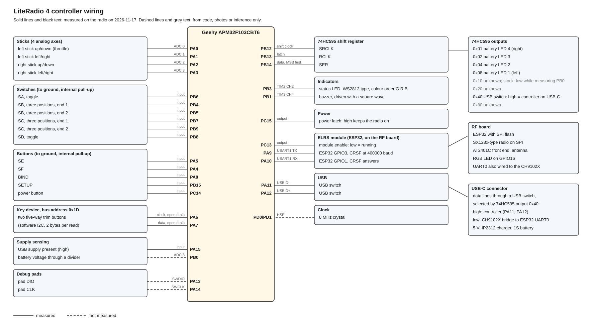

# Wiring of the LiteRadio 4 controller

What the controller MCU is connected to, as far as it is known on 2026-11-17.
The observations behind each entry are in [HARDWARE.md](HARDWARE.md).

Solid lines are connections whose function was measured on the radio. Dashed
lines and grey text come from the stock code, from a photo of the board or
from inference, and were not measured.

## Parts on the boards

Read from a published photo of an opened LiteRadio 4 SE ("LR4 SE Main Board
V1.0-IV", "LR4 SE TX RF Board V1.0-II"). The board in the tested radio was not
photographed for this project, so the list is not verified against it.

| Part | Marking | Role |
|------|---------|------|
| MCU | Geehy APM32F103CBT6 | controller; confirmed by its chip ID over SWD |
| Shift register | 74HC595D | eight control outputs |
| USB bridge | CH9102X | USB to serial for the ESP32 |
| Charger | IP2312, with a 1 uH inductor | single-cell battery charger |
| Small 10-pin IC next to the bridge | not readable | hypothesis: the USB data switch |
| RF board | ESP32 with Winbond SPI flash, a radio IC, AT2401C | ELRS transmitter |
| LEDs | one RGB LED, four white LEDs | status and battery level |
| Buzzer, 8 MHz crystal, SWD pads (DIO, CLK, GND, 3.3 V) | | |

The key device at bus address 0x1D that reads the trim buttons is not
identified. A four-wire cable leaves the main board next to the RF board;
hypothesis: it carries supply and the two bus lines to the trim button board.

## Pin list

| Pin | Direction | Function | Measured |
|-----|-----------|----------|----------|
| PA0 | analog in | left stick up/down (throttle), ADC channel 0 | yes |
| PA1 | analog in | left stick left/right, ADC channel 1 | yes |
| PA2 | analog in | right stick up/down, ADC channel 2 | yes |
| PA3 | analog in | right stick left/right, ADC channel 3 | yes |
| PA4 | in, pull-up | button SF, low when pressed | yes |
| PA5 | in, pull-up | button SE, low when pressed | yes |
| PA6 | open-drain out | key device clock (software I2C) | yes |
| PA7 | open drain | key device data | yes |
| PA8 | in, pull-up | BIND button, low when pressed | yes |
| PA9 | out | USART1 TX to the ELRS module, CRSF at 400000 baud | yes |
| PA10 | in | USART1 RX from the ELRS module | yes |
| PA11, PA12 | USB | D-, D+ to the USB switch | yes |
| PA13, PA14 | SWD | debug pads | used for the readback, not traced |
| PA15 | in | high while USB supply is present | yes |
| PB0 | analog in | battery voltage, ADC channel 8 | value read; meaning from the stock code |
| PB1 | out | buzzer, TIM3 channel 4 | yes |
| PB2 | in | reads low; the stock firmware sets a pull-down | function unknown |
| PB3 | out | status LED data, WS2812 type, TIM2 channel 2 | yes |
| PB4, PB5 | in, pull-up | switch SB | yes |
| PB6 | in, pull-up | switch SA | yes |
| PB7, PB9 | in, pull-up | switch SC | yes |
| PB8 | in, pull-up | switch SD | yes |
| PB10, PB11 | - | follow the internal pulls; driving them high showed nothing | unconnected as far as seen |
| PB12 | out | shift register clock | yes |
| PB13 | out | shift register latch | yes |
| PB14 | out | shift register data, most significant bit first | yes |
| PB15 | in, pull-up | SETUP button, low when pressed | yes |
| PC13 | out | ELRS module enable, low = module runs | yes |
| PC14 | in, pull-up | power button, low when pressed | yes |
| PC15 | out | power latch, high keeps the radio on | yes |

## Shift register outputs

| Output | Function | Measured |
|--------|----------|----------|
| 0x01 | battery LED 4 (rightmost), lit when high | yes |
| 0x02 | battery LED 3 | yes |
| 0x04 | battery LED 2 | yes |
| 0x08 | battery LED 1 (leftmost) | yes |
| 0x10 | unknown | see below |
| 0x20 | unknown | see below |
| 0x40 | USB switch: high = controller on the USB-C connector, low = CH9102X bridge | yes |
| 0x80 | unknown | see below |

Outputs 0x10, 0x20 and 0x80 had no visible effect, no effect on the CRSF
answers, and no effect on how the ESP32 starts: its boot message read
`rst:0x1 (POWERON_RESET), boot:0x13 (SPI_FAST_FLASH_BOOT)` for every
combination tried, including the pattern the vendor bootloader plays on its
second SETUP press in update mode (0x80 high, then 0x10 low, 0x20 low, 0x10
high, 0x20 high). What is known from code:

- The stock firmware sets 0x10 low for 100 ms before it reads PB0 while USB
  supply is present, and high again afterwards. On USB, PB0 read 6 counts
  higher with 0x10 high. Hypothesis: 0x10 enables charging.
- The bootloader has three USB states selected with SETUP: 0x40 high
  (controller on USB), 0x40 and 0x80 low (bridge on USB, module enabled),
  and 0x80 high followed by the 0x10/0x20 pattern. The purpose of the third
  state is not known.

## ELRS module

| Signal | Controller side | Module side |
|--------|-----------------|-------------|
| CRSF to the module | PA9, USART1 TX | ESP32 GPIO3 (`serial_rx` in the ELRS target) |
| CRSF from the module | PA10, USART1 RX | ESP32 GPIO1 (`serial_tx`) |
| Enable | PC13, low = run | supply switch or reset, not distinguished |
| Flashing | - | ESP32 UART0 also reaches the CH9102X bridge |

With PC13 low the module starts with a power-on reset message and answers
CRSF device pings. The bridge receives the module's output at the same time.
The module's own pins (radio on SPI, front end control, RGB LED on GPIO16)
are in the ELRS hardware target of the sibling repository.

## USB

The USB-C data lines go to a switch controlled by shift register output 0x40.
The host only notices a change of that output when the device that is leaving
disconnects first: the vendor bootloader powers its USB peripheral down and
holds PA12 low for 700 ms. Switching while the controller's USB device is
active leaves the host talking to a device that is no longer there.

## Power

- PC15 high keeps the radio on after the power button is released; PC15 low
  switches it off on battery.
- With USB supply the MCU runs regardless of PC15.
- PA15 tells USB supply from battery operation.
- The charger is an IP2312 according to the board photo. Its connection to
  the MCU is not established.

## Not established

- Function of shift register outputs 0x10, 0x20 and 0x80, and of PB2.
- Type of the key device at 0x1D and of the USB switch.
- Whether PC13 switches the module's supply or its reset.
- Volts per count on PB0.
- Whether a watchdog is forced on by the option bytes.

Tracing these needs the board itself: a multimeter in continuity mode between
the 74HC595 output pins and the candidate parts would settle the first two.
